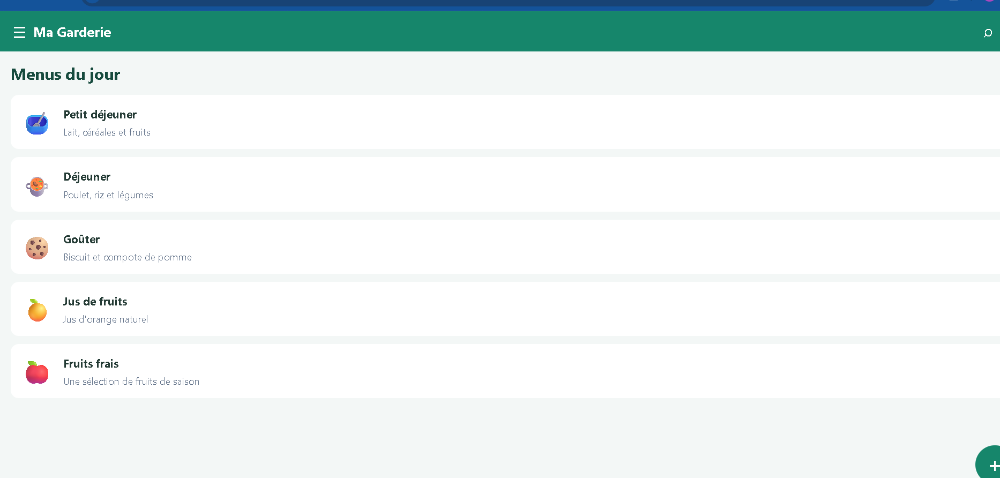
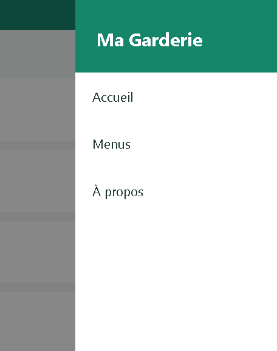
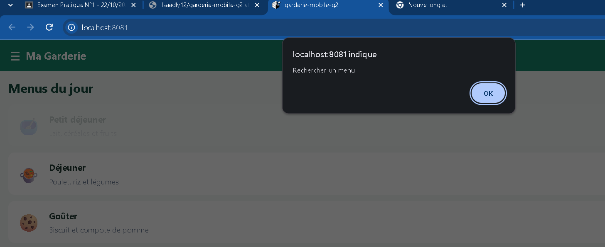

# Ma Garderie

Application mobile de gestion et d'affichage des menus quotidiens d'une garderie.

## Présentation

Ma Garderie permet de consulter les menus proposés aux enfants :
- Petit déjeuner
- Déjeuner
- Goûter
- Jus de fruits
- Fruits frais

## Technologies utilisées

- React Native
- Expo
- JavaScript
- Git et GitHub

## Fonctionnalités

- Écran de démarrage avec le nom de l'application et un message de bienvenue.
- Transition automatique vers la page principale après 3 secondes.
- Barre supérieure avec les boutons Recherche et Notifications.
- Menu de navigation : Accueil, Menus et À propos.
- Affichage des menus avec FlatList.
- Bouton d'ajout de menu.
- Affichage du titre du menu sélectionné.

## Installation

Cloner le dépôt :

```bash
git clone https://github.com/fsaadly12/garderie-mobile-g2.git
cd garderie-mobile-g2
```

Installer les dépendances :

```bash
npm install
npx expo install react-dom react-native-web
```

## Exécution

```bash
npx expo start
```

Pour lancer la version web :

```bash
npx expo start --web
```

## Captures d'écran

### Splash Screen


### Page principale et liste des menus



### Drawer ouvert



### Interaction avec un menu



## Git et GitHub

Dépôt public : https://github.com/fsaadly12/garderie-mobile-g2

Branches prévues :
- feature/init-project
- feature/splash-screen
- feature/home-page
- feature/list-view
- feature/interactions
- docs/readme
